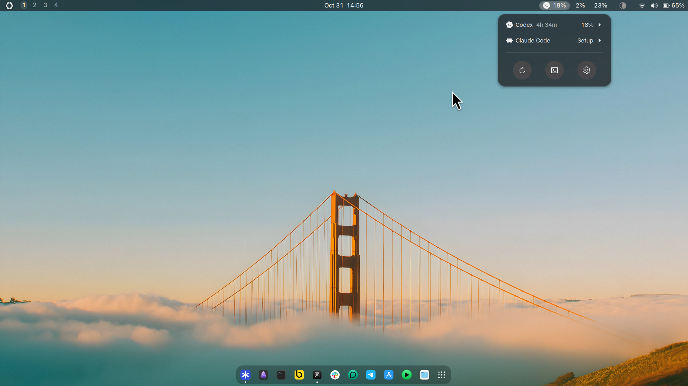
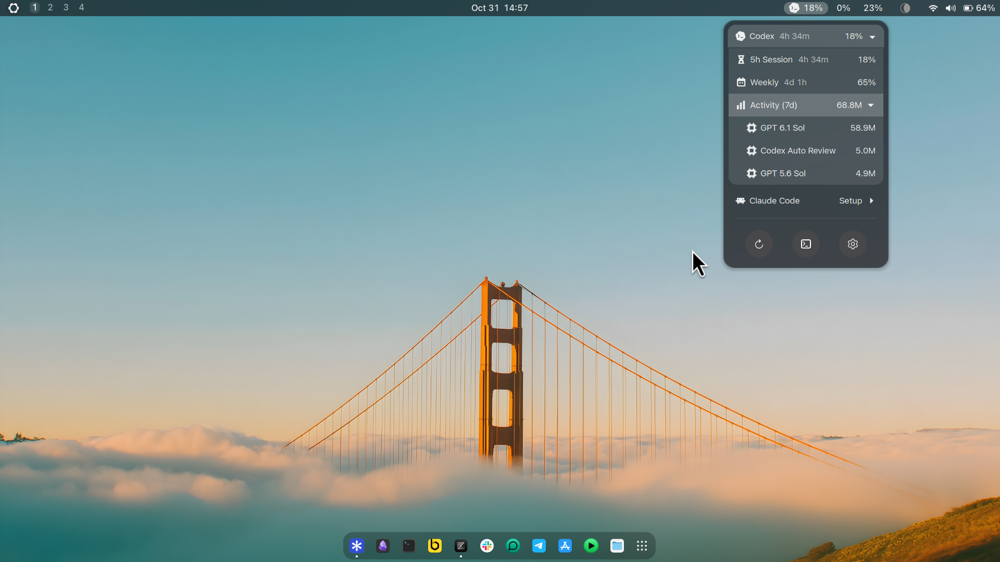

# UsageBeam

Codex and Claude Code usage, right in your GNOME panel.

See how much of your allowance you've used, when it renews, and which models
you've been using. UsageBeam keeps the essentials one click away while you work.



## At a glance

- **Know your limits.** Check session and weekly allowances with time until renewal.
- **See your activity.** Explore the past seven days of tokens, broken down by model.
- **Get a heads-up.** Receive usage alerts at your chosen threshold.
- **Keep moving.** Open your provider in a terminal directly from the menu.
- **Feel at home.** A native GNOME look and feel.

## Install

You'll need **GNOME Shell 50** and at least one installed, signed-in provider:
[Codex CLI](https://github.com/openai/codex) or
[Claude Code](https://code.claude.com/docs/en/setup).

Download the ZIP from [GitHub Releases](https://github.com/kcnewman/usagebeam/releases/latest),
then install it:

```sh
gnome-extensions install --force ./usagebeam@oo7kc.github.io-2.1.0.zip
```

Log out and back in, then enable UsageBeam:

```sh
gnome-extensions enable usagebeam@oo7kc.github.io
```

To upgrade, install the new ZIP with the same command and log in again. Your
settings are kept. The terminal shortcut requires a desktop terminal app.

## Your usage, one click away

Click the panel indicator to see each provider's usage and reset time. Expand a
provider to see its limits and make it the selected provider for the panel and
terminal shortcut. Expand **Activity (7d)** to see tokens by model.



The three buttons at the bottom refresh usage, open the selected provider in a
terminal, and open settings.

In **General**, choose your providers, menu order, panel position, refresh
interval and alerts. **Usage details** shows the latest saved status and any
issues reading your activity. It also lets you choose how long to keep saved
usage or clear it. Your provider history and sign-in are kept when you clear data.

## What the numbers mean

**Percentages** show how much of a provider's account allowance you've used for
that limit period. The time beside a heading is how long remains until it
renews. Account limits can include usage from other devices.

**Activity (7d)** is the total tokens recorded on this device over the past
seven calendar days, including today. It includes input, output and cache tokens
according to each provider's counting rules. **M** means million tokens.

Activity is separate from your allowance percentage and isn't a cost estimate.
Changing retention in settings doesn't change the seven-day view.

If some records can't be read, activity totals may be incomplete. Check
**Settings → Usage details** for more information.

## Privacy

UsageBeam reads your providers' existing sign-in and usage history. It saves
usage totals locally, without copying your credentials or saving your prompts
and conversations. There is no telemetry.

## Need help?

If account limits are unavailable, open the provider's CLI, confirm you're signed
in, then refresh UsageBeam. Some account types don't provide subscription limits;
local activity may still be available.

After installing a provider or updating the extension, log out and back in if
the change hasn't appeared. For other problems, check **Settings → Usage details**
or [report an issue](https://github.com/kcnewman/usagebeam/issues).

## Remove

```sh
gnome-extensions disable usagebeam@oo7kc.github.io
gnome-extensions uninstall usagebeam@oo7kc.github.io
```

[Release notes](CHANGELOG.md) · [Development](docs/development.md) · [License](LICENSE)

Independent software, unaffiliated with OpenAI or Anthropic. Inspired by the
[Omarchy Agents plugin](https://github.com/omacom/omarchy) and
[Vitals' compact GNOME interface](https://github.com/corecoding/Vitals).
Licensed under [MIT](LICENSE).
