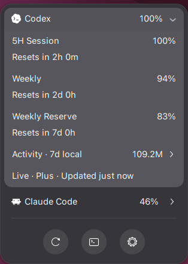

# UsageBeam

Your coding usage, one glance away.

UsageBeam brings Codex and Claude Code usage to the GNOME top panel. Check
account limits and reset times, explore seven days of local activity, and open
your provider in a terminal—all from a small, native menu.



## Features

- Current account usage and reset windows, kept separate from local token totals.
- Expandable provider rows with model totals and daily activity.
- GNOME's fonts, colors, keyboard navigation, and light/dark styling.
- Refresh, provider terminal, and settings shortcuts.
- Configurable provider order, panel side, refresh interval, and usage alerts.
- Private local storage, with no telemetry or runtime package dependencies.

## Install

Requires **GNOME Shell 50** and a signed-in [Codex CLI](https://github.com/openai/codex)
or [Claude Code](https://code.claude.com/docs/en/setup). A desktop terminal is
needed for the terminal shortcut; `xdg-terminal-exec` is preferred when installed.

Download the ZIP from [GitHub Releases](https://github.com/oo7kc/usagebeam/releases/latest),
then install it:

```sh
gnome-extensions install --force ./usagebeam@oo7kc.github.io-2.0.0.zip
```

Log out and back in, then enable UsageBeam:

```sh
gnome-extensions enable usagebeam@oo7kc.github.io
```

The same installation command upgrades an existing copy. Your settings are retained.

## Use

Click the panel indicator to open the menu. Expand a provider to see its limits
and select it for the panel and terminal shortcut. Expand **Activity** to see
local model totals and daily usage. Closing the menu collapses the details while
remembering the selected provider.

The three buttons at the bottom refresh usage, open the selected provider in a
terminal, and open settings. Terminal sessions start in your home directory.

In settings, choose providers and their order, left or right panel placement,
refresh frequency, alert thresholds, and activity retention. **Clear saved usage**
removes UsageBeam's derived data; it does not delete provider history.

## How the numbers work

Codex account limits come from its installed CLI app-server. Claude Code limits
use its saved OAuth sign-in and account-usage endpoint. Availability depends on
the account and installed client; API-key accounts may not expose subscription
limits. Provider interfaces can change independently of UsageBeam.

Local activity comes from session records on this device. It includes input,
output, and cache tokens using each provider's accounting rules. It is not an
account-wide quota or a billing estimate. Missing data stays unavailable rather
than being shown as zero; cached or incomplete data is labelled.

If limits are unavailable, open the provider's CLI, confirm it is signed in, and
refresh. Local activity may remain available independently. After upgrading the
extension or installing a CLI, a fresh GNOME login may be needed.

## Privacy

UsageBeam stores only derived usage metadata under `$XDG_STATE_HOME/usagebeam`
and `$XDG_CACHE_HOME/usagebeam`, with private file permissions. It does not store
credentials, prompts, responses, transcripts, or raw account/session identifiers.
Codex manages its own authentication; Claude's saved token is read only for its
usage request and is never copied into UsageBeam's storage.

## Remove

```sh
gnome-extensions disable usagebeam@oo7kc.github.io
gnome-extensions uninstall usagebeam@oo7kc.github.io
```

For source builds and maintenance, see [Development](docs/development.md).
Report problems in [GitHub Issues](https://github.com/oo7kc/usagebeam/issues).

Independent software, unaffiliated with OpenAI or Anthropic. Inspired by the
[Omarchy Agents plugin](https://github.com/omacom/omarchy) and
[Vitals' compact GNOME interface](https://github.com/corecoding/Vitals).
Licensed under [MIT](LICENSE).
